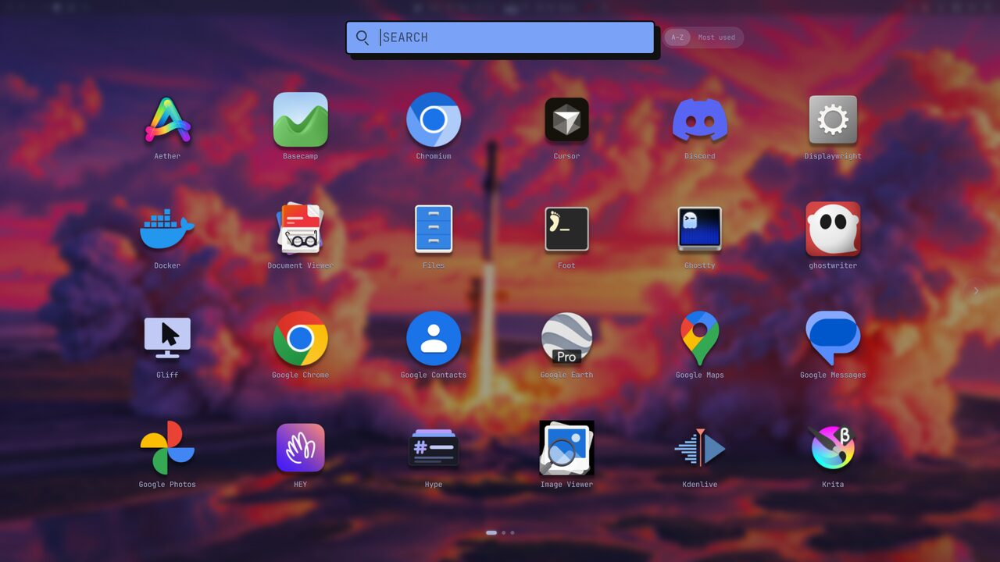
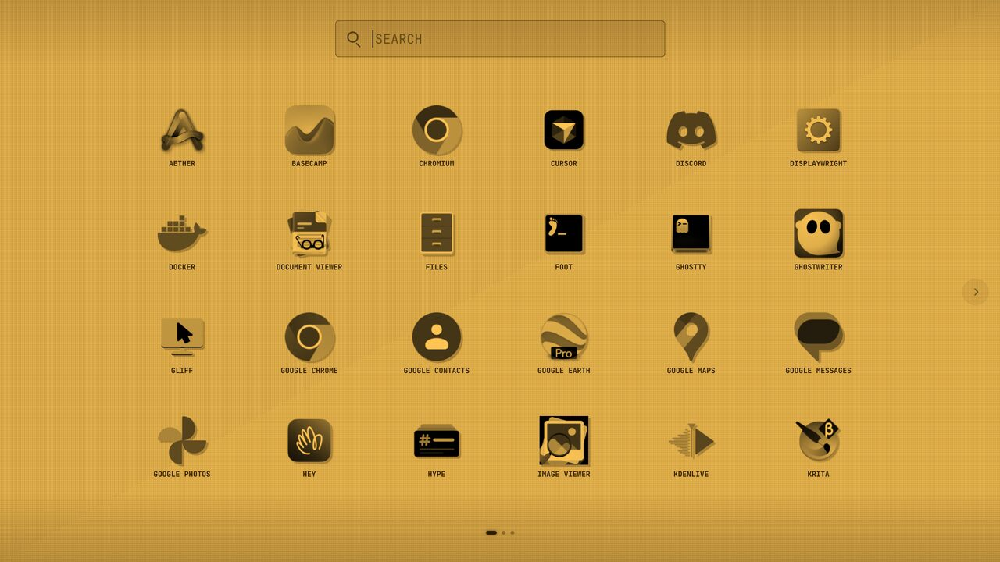
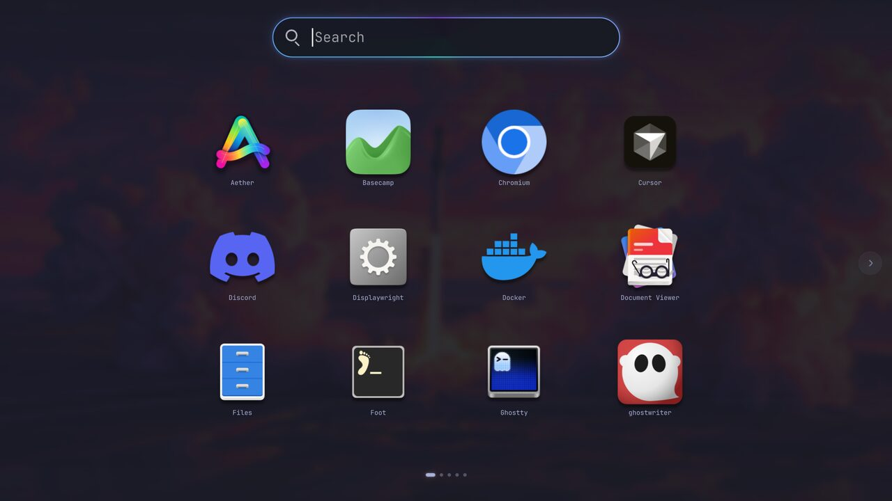

# Launchpad Ultra for Omarchy

<p align="center">
  
  
  
  
</p>

A fullscreen app grid for the [Omarchy](https://omarchy.org) shell: every
installed app on sliding pages of six columns by four rows, over a frosted view
of the desktop, with a search pill at the top.

It is a shell plugin, so it opens instantly, lists whatever apps are installed
on your machine, and uses the same search and hidden-app settings as the
Omarchy launcher.

It also brings its own dock: Omarchy's dock, with the apps button opening
Launchpad, a **Launchpad settings** row in its right-click menu, an icon size
setting, and hold-to-move like the bar: hold any icon still for a moment, or hold or drag the apps button, and the dock follows
the pointer to the nearest screen edge, the way the bar moves. Drag an icon
along the dock to reorder it, or pull a kept app off the dock and let go to
remove it; drag an app from Launchpad onto the dock to add it. Enabling the plugin switches the built-in dock off; removing the plugin
brings it back. `omarchy dock` and the dock's settings in `shell.json` keep
working as before.

## Install

```bash
omarchy plugin add https://github.com/A01101101/launchpad-ultra.git --enable
```

Update to the latest version, or remove it (which brings Omarchy's own dock
back):

```bash
omarchy plugin update launchpad-ultra
omarchy plugin remove launchpad-ultra
```

Installed it back when its id was `launchpad`? Remove that
one and add it again; your settings are kept:

```bash
omarchy plugin remove launchpad --yes
omarchy plugin add https://github.com/A01101101/launchpad-ultra.git --enable
```

and change `panel = "launchpad"` to `panel = "launchpad-ultra"` in your key
binding.

## Open it

From a terminal or script:

```bash
omarchy-shell shell toggle launchpad-ultra
```

From a key, in `~/.config/hypr/bindings.lua`:

```lua
o.bind("SUPER + ALT + SPACE", "Launchpad", { panel = "launchpad-ultra" })
```

Or click the apps button on the dock (the dock shows on floating workspaces).

## Settings

Right-click the dock's apps button and pick **Launchpad settings**, or
right-click the search bar. Four tabs: Grid, Pages, Search, Theme. While the
card is open, turn on **Drag to move and resize** on the Search tab to drag the
search bar around and drag its corner to resize it. The grid behind the card
redraws as you change things.

| Setting | Range | Default |
|---|---|---|
| Columns | 4 to 10 | 6 |
| Rows | 2 to 6 | 4 |
| Icon size | 56 to 128 | 86 |
| Show app names | on / off | on |
| Style | Frosted / LCD (the whole screen turns green, with pixel icons) | Frosted |
| LCD tint | Green / Amber / Blue / Grey / Violet / Paper / Night (dark screen, light ink) | Green |
| Pixel shadow (LCD) | None to 12 | 3 |
| Backdrop darkness | 31% to 90% | 34% |
| Use theme colors | on / off | off (dark frosted glass, white text) |
| Settings button | on / off (the corner cog; off, open settings from the dock menu or by right-clicking the search bar) | off |
| Reopen on the last page | on / off | off |
| Scrolling | Pages / Smooth (one long grid that scrolls) | Pages |
| Scroll sensitivity | 1 to 5 | 3 |
| Pages slide in from | Right / Left / Bottom / Top | Right |
| Page indicator | Pill / Dots / Numbers / Off | Pill |
| Page arrows | Round / Plain / Edge / Off | Round |
| Click on empty space | Close / Turn page (then double-click closes) | Close |
| Search look | Frosted / Plain / Retro (Windows 98) / Corners (viewfinder corners that close in as you type) / Big text (giant capitals over a rule) / Block (accent block, black outline, hard shadow it presses into) / Glow (dark pill in a glowing ring that turns while you search) | Frosted |
| Search icon style | Classic / Fine / Bold / Filled / Square / Pixel / Arrow / Dot / Off | Classic |
| Search icon size | 60% to 200% | 100% |
| Search underline | on / off (Plain look) | on |
| Search cursor | Line / Block / Underscore | Line |
| Blinking cursor | on / off | on |
| Search position | Top / Bottom / Custom | Top |
| Search bar size | 60% to 240% | 100% |
| Search bar border | None to 6 (Frosted, Glow and LCD) | 1 |
| Placeholder | Search / Rotating hints / Confused face / Custom | Search |
| Drag to move and resize | on / off (starts off each time settings open) | off |
| Keep search bar still | on / off (no animation in the bar or placeholder) | off |
| Sort button | on / off | off |
| Sort apps by | A–Z / Most used | A–Z |
| Dock icon size | 24 to 64 (in `launchpad.json` only) | 36 |
| Dock bounce | Rubber (a hop with squash, stretch and dying rebounds) / Jelly (one stretchy hop, then a wobble that settles) / Off | Rubber |

The sort button sits beside the search bar. "Most used" counts how often each app
is opened from Launchpad or its dock, kept in
`~/.local/state/omarchy/launchpad-usage.json`; apps opened any other way are
not counted. A search always shows the best matches first.

The direction, indicator, arrow and empty-click settings apply when scrolling
by pages and are greyed out in smooth mode. With "Turn page", a right-click on
empty space still closes Launchpad. The dock's position and auto-hide are Omarchy's own, changed with
`omarchy dock`.

They are saved in `~/.config/omarchy/launchpad.json`, which you can also edit
by hand, and scripts can change them while the shell runs:

```bash
omarchy-shell shell call launchpad-ultra configure '{"columns": 8, "rows": 3}'
omarchy-shell shell summon launchpad-ultra '{"view": "settings"}'
omarchy-shell shell summon launchpad-ultra '{"view": "settings", "tab": "search"}'
```

## Blur the desktop behind it

Without this the desktop shows through dimmed but sharp. Add to
`~/.config/hypr/hyprland.lua`:

```lua
hl.layer_rule({ match = { namespace = "^launchpad$" }, blur = true, ignore_alpha = 0.3 })
```

## Keys

| Key | Does |
|---|---|
| Type | Search by name, description or keyword |
| Enter | Open the first match |
| Left / Right, Page Up / Page Down, scroll | Turn the page |
| Up / Down | Put the keyboard on an app; the arrows then move between apps |
| Enter (with an app selected) | Open it |
| Delete (with an app selected) | Uninstall it, after asking |
| Escape | Clear the search, then close settings, then close |

Clicking empty space also closes it.

## With the mouse

- Click an app to open it.
- Right-click an app to open it, keep it in the dock or take it out, or
  uninstall it.
- Drag an app onto the dock to keep it there.

## Translating

Strings live in `i18n/en.json`. Add a file named after an Omarchy language code
(`da.json`, `pt-BR.json`) with the same keys; missing strings fall back to
English.

## Notes

- The manifest lists the `menu` kind next to `overlay` because the shell only
  hands its app list to plugins of that kind.
- The dock in `dock/` is copied from Omarchy (MIT, see `dock/LICENSE`). It will
  not pick up later changes to Omarchy's dock by itself. Its strings, in every
  language Omarchy ships, are copied into `i18n/`.
- `tests/check.py` checks the plugin against Omarchy's plugin guidelines: plain
  text everywhere, own string catalogs, animation lengths and easing.
- If you already run your own clone of the dock, disable it first; two docks
  would both show.
- While developing: the shell keeps this plugin loaded between opens, so after
  editing run `omarchy restart shell` if a change does not show up.

## License

MIT. The dock in `dock/` is adapted from Omarchy's dock, © David Heinemeier Hansson, MIT; see `dock/LICENSE`.
